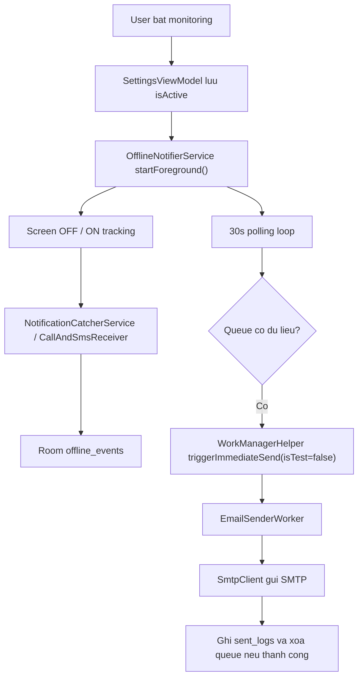

# Offline Notifier Architecture

## Overview

Offline Notifier la mot single-module Android app (`:app`) duoc to chuc quanh 5 khoi chinh:

- Compose UI cho cau hinh va xem lich su
- DataStore de luu settings runtime
- Room de luu offline event queue va send history
- Foreground/background components de thu thap su kien
- WorkManager worker de tong hop va gui email

## Main Components

### UI Layer

- `MainActivity` dung `SettingsViewModel` va mo 2 man hinh:
  - `SettingsScreen`
  - `LogHistoryScreen`
- `SettingsScreen` cho phep:
  - bat/tat monitoring
  - cau hinh sender/recipient/app password
  - chon chu ky gui
  - loc app notification
  - trigger test send
  - cap quyen qua Shizuku

### Settings Layer

- `SettingsRepository` doc/ghi `DataStore<Preferences>`
- Cac setting chinh:
  - sender email
  - recipient email
  - app password
  - interval
  - active flag
  - bo loc calls / SMS / apps
  - selected apps

### Event Capture Layer

- `OfflineNotifierService`
  - chay foreground
  - track screen on/off
  - start watchdog
  - doi 30 giay moi nhip de trigger send neu queue co du lieu
- `NotificationCatcherService`
  - nghe `NotificationListenerService`
  - chi ghi su kien khi man hinh tat
  - co dedup 3 giay cho cung package/title/body
- `CallAndSmsReceiver`
  - nhan SMS broadcast
  - nhan `PHONE_STATE`
  - chi ghi su kien khi service dang bat va man hinh dang tat hoac vua tat gan day

### Persistence Layer

- `AppDatabase`
  - `offline_events`
  - `sent_logs`
- `EventDao`
  - insert
  - list
  - delete selected
  - clear all
- `SentLogDao`
  - insert log gui mail
  - read history
  - clear history

### Delivery Layer

- `WorkManagerHelper`
  - enqueue one-time work cho auto send va test send bang 2 unique work names rieng
  - cancel tat ca email-related work khi tat monitoring
- `EmailSenderWorker`
  - doc settings + Room queue
  - build HTML summary
  - gui qua `SmtpClient`
  - ghi `SentLogEntity`
  - xoa queue neu gui thanh cong
- `SmtpClient`
  - SMTP Gmail tren port 587 + STARTTLS

## Lifecycle Flow

## Permissions And Recovery

- `grant_permissions.cmd` cap quyen ADB cho may that
- `ShizukuHelper` co the chay mot nhom lenh tuong tu truc tiep tren thiet bi
- `WatchdogReceiver` co 2 vai tro:
  - xu ly watchdog tick dinh ky
  - phuc hoi service sau reboot qua `BOOT_COMPLETED`

Sau ban cap nhat hien tai:

- Manifest da khai bao `RECEIVE_BOOT_COMPLETED`
- `WatchdogReceiver` chi khoi dong lai service neu `isActive = true`
- `WorkManagerHelper` khong con dung chung unique work name giua test send va auto send

## Operational Risks

- Mat khau email hien luu plain trong DataStore
- `fallbackToDestructiveMigration()` co the xoa du lieu queue/log khi doi schema
- App phu thuoc manh vao OEM behavior, notification listener va battery policy
- Chua co automated tests bao ve luong watchdog, boot recovery va email queue

## Recommended Verification

1. Bat monitoring, tat man hinh, tao 1 notification test, xac nhan event vao queue.
2. Trigger test send, xac nhan `sent_logs` co ban ghi moi.
3. Tat monitoring, xac nhan pending work bi huy.
4. Reboot may khi `isActive = true`, xac nhan service tu khoi dong lai.
5. Reboot may khi `isActive = false`, xac nhan service khong tu khoi dong lai.
