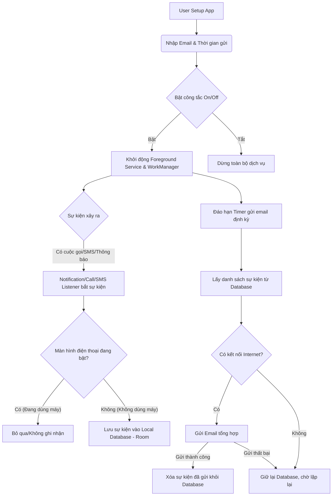

# Offline Notifier App Specifications

## 1. Executive Summary
Ứng dụng Android chạy ngầm, theo dõi và ghi nhận các sự kiện quan trọng (cuộc gọi nhỡ, tin nhắn SMS/Zalo/Messenger, thông báo ứng dụng) khi người dùng không tương tác với thiết bị (tắt màn hình/không sử dụng). Sau một khoảng thời gian cấu hình trước, ứng dụng sẽ tổng hợp và gửi báo cáo qua email được chỉ định. 

Mục tiêu chính: Giúp người dùng quản lý thông tin liên lạc quan trọng khi phải rời xa điện thoại, đảm bảo không bỏ lỡ thông báo khẩn cấp.

## 2. User Stories
- **Cấu hình Email**: Là người dùng, tôi muốn nhập địa chỉ email nhận thông báo để ứng dụng biết gửi đi đâu.
- **Bật/Tắt Dễ Dàng**: Là người dùng, tôi muốn có một công tắc (switch/button) rõ ràng trên giao diện chính để bật/tắt chức năng theo dõi ngay lập tức.
- **Tùy Chỉnh Thời Gian**: Là người dùng, tôi muốn cài đặt bao lâu (ví dụ 15 phút, 30 phút, 1 tiếng) ứng dụng sẽ kiểm tra và gửi báo cáo 1 lần.
- **Báo Cáo Chi Tiết**: Là người dùng, tôi muốn nhận được email chứa: Người gọi/nhắn tin, Nội dung tin nhắn (nếu có thể đọc), Thời gian xảy ra, và Tên ứng dụng phát ra thông báo.
- **Ổn Định Khi Mất Mạng**: Là người dùng, nếu lúc đó điện thoại tôi bị mất mạng, tôi muốn ứng dụng lưu lại thông báo cục bộ và tự động gửi bù ngay khi có mạng trở lại.
- **Chống Bị Tắt Ngầm (Xiaomi)**: Là người dùng Xiaomi, tôi muốn ứng dụng không bị hệ thống MIUI/HyperOS "kill" (đóng ngầm) để thông báo luôn được ghi nhận liên tục.

## 3. Tech Stack & Environment
- **OS Target**: Android 16 (Tương thích ngược Android 12+) - Dành riêng cho Xiaomi 14 (HyperOS).
- **Core Language**: Kotlin + Android SDK.
- **UI Architecture**: Jetpack Compose (Modern UI) hoặc XML (Classic) + Material Design 3.
- **Architecture Pattern**: MVVM (Model-View-ViewModel) + Clean Architecture cơ bản.
- **Local Database**: Room Database (để lưu thông báo khi mất mạng - Offline Queue).
- **Background Processing**: WorkManager (để lên lịch gửi email định kỳ) + Foreground Service (để giữ app luôn sống).
- **Email Sending**: 
  - Option 1 (Khuyên dùng): Gửi qua một API trung gian (Backend/Serverless Function) tránh lộ mật khẩu SMTP trong APK.
  - Option 2 (Đơn giản): Dùng thư viện JavaMail API (Phải dùng App Password của Gmail).
- **ADB Permissions**: Các quyền đặc biệt cấp qua máy tính chạy lệnh ADB (vì máy CHƯA ROOT).

## 4. ADB Permissions (Cực kỳ quan trọng)
Do máy chưa root và target Android 16, việc đọc thông báo và chạy ngầm cần các quyền đặc biệt cấp phát qua ADB:
```bash
# 1. Cấp quyền đọc thông báo (Notification Listener)
adb shell cmd notification allow_listener com.yourpackage.name/com.yourpackage.name.NotificationListenerService

# 2. Cấp quyền đọc Call Log (Cuộc gọi nhỡ)
adb shell pm grant com.yourpackage.name android.permission.READ_CALL_LOG

# 3. Cấp quyền đọc SMS/MMS
adb shell pm grant com.yourpackage.name android.permission.READ_SMS
adb shell pm grant com.yourpackage.name android.permission.RECEIVE_SMS

# 4. (Xiaomi Specific) Loại bỏ hạn chế pin (App Standby)
adb shell dumpsys deviceidle whitelist +com.yourpackage.name

# 5. Quyền đọc trạng thái Usage (Xác định thiết bị đang không được dùng)
adb shell pm grant com.yourpackage.name android.permission.PACKAGE_USAGE_STATS
```

## 5. Logic Flowchart



## 6. Hidden Requirements (Cạm bẫy kỹ thuật)
- **Xiaomi/HyperOS Aggressive Task Killer**: Hệ điều hành của Xiaomi giết app ngầm rất gắt. Giải pháp: Bắt buộc dùng Foreground Service kết hợp thông báo vô hình (hoặc có hình mờ) + Hướng dẫn User vào cài đặt Tắt tối ưu hóa pin + Khóa (Pin) app trên màn hình Recent.
- **Notification Listener bị thu hồi (Revoked)**: Trên Android bản mới, nếu Update app hoặc khởi động động lại máy, dịch vụ nhận thông báo thỉnh thoảng bị tắt. Cần check liên tục và ép bật lại qua quyền Root/ADB nếu có, hoặc báo lên UI cho User tự bật lại.
- **Gmail Security**: Nếu dùng JavaMail API trực tiếp trên app tĩnh, bắt buộc User phải tự tạo "Mật khẩu ứng dụng" (App Password) trên tài khoản Google của họ, gửi thẳng mật khẩu cấp 1 sẽ báo lỗi và bị chặn.

## 7. Build Checklist & Setup
- [ ] Cài đặt Android Studio Ladybug/Koala.
- [ ] Khởi tạo dự án Kotlin, targetSDK 35/36 (Tương đương Android 15/16).
- [ ] Setup Room Database.
- [ ] Setup WorkManager.
- [ ] Setup giao diện Settings (Compose/Fragment).
- [ ] Chuẩn bị kịch bản lệnh ADB cho User copy-paste.
